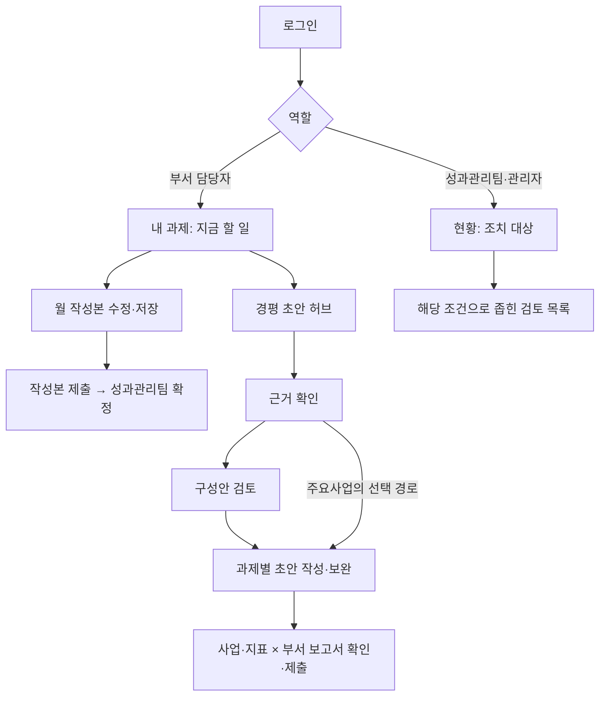

# 경영평가 Sherpa UI/UX 개선 핸드오프

- 작성일: 2026-10-21
- 대상: 일반 부서 담당자의 내 과제·과제관리카드·경평 초안, 이를 지원하는 성과관리팀 현황
- 용도: 기획·디자인·프론트엔드·백엔드·QA가 구현 범위와 완료 조건을 공유하는 제안서
- 상태: 현행 분석 및 개선 제안. 제품 UI와 업무 규칙은 변경하지 않음
- 분석 방법: 현행 코드·설계 문서 확인 → Sequential Thinking MCP 6단계 검토 → 로컬 앱 DOM 관찰 → 개선 명세 정리

## 1. 전달할 핵심 결정

**일반 사용자가 ‘내가 해야 할 일’을 찾고, ‘무엇에 저장하는지’를 이해하고, ‘다음 단계’로 이동하도록 기존 기능의 안내와 배치를 개선한다.** 한글 문서의 재현성 및 검토·확정 체계는 유지한다.

1. `/my`를 개인 업무 시작 화면으로 보강한다. 반려된 작성본, 확인할 점검, 진행할 초안을 우선 표시한다.
2. 과제명 클릭은 카드 열기로 유지하고, 경평 초안 진입에는 `경평 초안 열기`라는 텍스트를 제공한다.
3. 카드에는 `10월 작성본`, 초안에는 `2026 경평 초안`처럼 저장 대상을 명확히 표시한다. 저장과 제출의 상태를 별도로 표현한다.
4. 경평 초안은 `근거 확인 → 구성안 검토 → 초안 작성 → 확인·제출`의 흐름을 보여 준다. 이는 현재 상태를 안내하는 장치이며 모든 방문 때 다시 거치는 강제 튜토리얼이 아니다.
5. `제출을 막는 조건`과 `제출 전 확인 권고`를 구분한다. 현행 서버의 제출 판단을 UI가 그대로 설명하게 한다.
6. 기존 중립색·남색·파란색 계열과 공용 부품을 유지한다. 장식 추가보다 문구, 정보 순서, 클릭 영역, 상태 피드백을 우선 개선한다.

## 2. 조사 범위와 증거의 한계

### 2.1 확인 수준

| 구분 | 이번에 확인한 것 | 확인하지 못한 것 |
| --- | --- | --- |
| 코드 | 역할별 메뉴, 내 과제 목록, 카드 작성본, 초안 작성 공간, 제출 준비도, 디자인 토큰 | 실제 사용자의 이해도·업무 시간 |
| 브라우저 | 실행 중인 localhost:3000, 1375×762, 주요사업 선택 상태, 관리자 세션 | 일반 부서 계정의 편집·제출 전체 여정, 경영관리 실화면, 모바일 실측 |
| 확인 화면 | `/my`, `/dashboard`, 카드 전체 화면, `/my/report`, 과제별 경평 초안 | `/my/report` 부서 선택 후 내용의 실화면: 이번 관찰은 부서 선택 전까지만 확인 |
| 시각 검토 | DOM에 나타난 텍스트·컨트롤·크기 | `Page.captureScreenshot` 시간 초과로 픽셀 단위 외관·겹침·색 대비 실측은 미확인 |
| 실행 | 읽기 전용 탐색과 MCP 호출 | AI 생성, 파일 업로드, 저장, 제출 등 업무 데이터 변경은 수행하지 않음 |

이 문서에서 **확인**은 코드 또는 위 브라우저 관찰로 확인한 사실, **가설**은 사용성 검증이 필요한 예상 문제, **제안**은 향후 구현할 동작이다. 사용성 테스트 결과나 운영 통계로 해석하지 않는다. 관찰한 데이터의 수량은 로컬 화면의 예시이며 실제 운영 실적을 의미하지 않는다.

### 2.2 Sequential Thinking MCP 사용 기록

연결 도구 목록에 해당 서버가 노출되지 않아 로컬 설치된 `@modelcontextprotocol/server-sequential-thinking@2.0.0`을 stdio로 실행했다. MCP `initialize`·`tools/list` 후 `sequentialthinking`을 6회 호출했고 마지막 응답의 `nextThoughtNeeded=false`, `thoughtHistoryLength=6`을 확인했다.

| 검토 단계 | 정리한 결론 |
| --- | --- |
| 1. 사용자·범위 | 부서 시작 화면 `/my`와 성과관리팀 `/dashboard`를 구분 |
| 2. 제품 제약 | 한글 원본, 자동 저장, 작성본·원장 분리 등 기존 기능 유지 |
| 3. 접근성·진입 | 다음 행동과 텍스트 진입점 우선 |
| 4. 초안 흐름 | 상태 기반 안내, 트랙별 작성 규칙 보존 |
| 5. 제출 정책 | 필수 누락과 확인 권고 구분 |
| 6. 구현 전달 | 화면 명세·대상 파일·수용 기준·검증 시나리오 제공 |

[실행 영수증 및 단계별 결론](./evidence/2026-10-21-ux/sequential-thinking.json), [브라우저 DOM 관찰 요약](./evidence/2026-10-21-ux/browser-observations.json). MCP는 검토를 구조화하는 데 사용했으며, 사용자 조사나 품질 점수를 자동 산출한 도구로 취급하지 않는다.

## 3. 사용자와 현행 구조

### 3.1 일반 사용자 관점의 주요 과업

아래 인물상은 인터뷰 결과가 아니라 현행 권한·업무 흐름에 맞춘 검증용 가설이다.

| 사용자 | 하고 싶은 일 | 가장 큰 불확실성 | 성공 경험 |
| --- | --- | --- | --- |
| 처음 배정된 부서 담당자 | 내 과제를 찾고 이번 달 실적 입력 | 어디를 눌러야 하고 원장이 바뀌는지 모름 | 담당 과제 → 작성 대상 → 제출 결과를 설명 없이 이해 |
| 매월 사용하는 담당자 | 돌려받은 부분만 보완 | 여러 화면 중 수정할 곳을 다시 찾음 | 보완 메모에서 해당 위치로 바로 이동 |
| 연말 초안을 쓰는 담당자 | 실적 자료로 초안을 만들고 제출 | 구성안·짜임·판면·조판의 차이를 모름 | 자료와 초안 상태를 보고 다음 한 가지 행동 선택 |
| 성과관리팀 | 부서 업무를 지원하고 검토 | 전체 수치에서 실제 조치 대상을 다시 찾음 | 할 일 클릭 시 같은 대상 범위가 열린 상태로 도착 |

### 3.2 실제 진입점과 권한

- 부서 담당자 메뉴: `내 과제 / 경평 초안 / 공통 지식`. 내 과제 안에 `과제 / 점검 결과`가 있다.
- `/dashboard`는 `requireAtLeast("pmo")`로 보호된다. 개인 대시보드 개선은 `/my` 안에서 구현한다.
- 성과관리팀·관리자의 `/my`는 부서 화면 보기이며 읽기 전용이다. 편집할 수 있는 개인 작업 공간으로 오해시키지 않는다.
- 경영관리·주요사업 트랙은 같은 틀을 사용한다. 표시되는 데이터와 안내 문구만 달라진다.
- 카드 상태, 초안 준비 상태, 보고서 제출 상태는 서로 다른 개념이다. 하나의 진행률로 합치지 않는다.

### 3.3 현행에서 잘 구현된 기반

원본 한글 모양을 유지하는 편집·HWPX 다운로드, 자동 저장과 저장 오류 상태, 부서 작성본 제출·회수·확정, 고정 영역 보호, AI 작업 경과 시간 안내, 근거 자료 업로드, 제출 준비도 계산이 이미 있다. 화면 공통 토큰·다섯 상태 톤·대화상자·초점 처리·목록 복귀 경로도 갖추고 있다. 개선은 이 기반을 재사용한다.

## 4. 핵심 문제와 개선 우선순위

P1은 주요 업무의 이해·진입을 개선하는 우선 작업, P2는 이후 효율·적응성을 높이는 작업이다. 이번 조사에서 재현한 업무 중단 버그는 없으므로 P0는 부여하지 않았다.

| ID | 확인 근거 | 일반 사용자에게 예상되는 문제(가설) | 제안 | 우선 |
| --- | --- | --- | --- | --- |
| UX-01 | `/my`는 과제 목록과 월 작성본 시작 수 중심 | 목록에서 오늘의 우선 작업을 스스로 판단 | 상단에 현재 내 차례인 작업과 바로가기 | P1 |
| UX-02 | `CardBoard` 초안 링크는 14px 아이콘과 p-1, aria-label·title 있음 | 접근 가능한 이름이 있어도 시각적으로 의미를 찾기 어려움 | `경평 초안 열기` 텍스트와 충분한 클릭 영역 | P1 |
| UX-03 | 카드에 작성본 띠·자동 저장, 보고서에도 별도 자동 저장 존재 | 저장하면 제출되거나 원장이 즉시 바뀐다고 오인 | 저장 대상·저장 상태·제출 상태를 분리 | P1 |
| UX-04 | 초안·구성안 전환, AI 초안·점검 결과, 근거 패널, 짜임 선택이 공존 | 처음부터 기능을 많이 학습해야 함 | 현재 단계와 추천 행동을 먼저 표시, 상세 설정은 펼치기 | P1 |
| UX-05 | 제출은 포함 과제의 초안 유무가 필수, 나머지는 확인 목록 | 경고를 모두 해결해야 제출 가능하다고 오인 | 필수 누락·확인 권고를 별도 구역으로 | P1 |
| UX-06 | 현황의 확정 대기·작성본 시작 전 링크가 모두 `/cards` | 수치 클릭 후 대상을 다시 찾음 | 필터 지원 추가 후 해당 대상·상태로 연결 | P1 |
| UX-07 | `submitReadiness`와 `TodoBoard` 등 이미 할 일 계산 존재 | 여러 요약이 같은 일을 다르게 셀 수 있음 | 기존 계산 재사용, 건수·단위·클릭 결과 일치 | P1 |
| UX-08 | 데스크톱 버튼 28/32px, 일부 트랙 버튼 DOM 높이 24px | 터치 환경에서 오작동 가능 | 터치 대상 44px 권장, 좁은 화면 작업 구조 재편 | P2 |
| UX-09 | 할 일 0건도 현황 패널에 노출, 업무와 초기 설정 혼합 | 바로 할 일을 찾는 데 시간이 듦 | 현재 조치가 필요한 행 우선, 완료·0건은 접기 | P2 |
| UX-10 | 부서 미지정·담당 과제 없음·보고서 미준비 안내 있음 | 기다려야 하는지 조치를 요청해야 하는지 불명확 | 원인·누가 해결하는지·그동안 가능한 행동 안내 | P1 |

## 5. 권장 사용자 여정과 정보 구조



기존 경로와 메뉴를 유지한다. 새 개인 대시보드 URL, 별도 보고서 생성 엔진, 새 권한 체계는 필요하지 않다. 안내 문구에서는 ‘경영평가 보고서 초안’을 사용해 약어를 처음 접하는 사용자도 이해하게 하고, 메뉴 `경평 초안`은 현행 이름을 유지한다.

## 6. 화면별 디자인·동작 명세

### 6.1 개인 시작 화면 `/my`

**목표:** 첫 화면에서 해야 할 작업과 작업 대상을 알 수 있게 한다.

```text
내 과제                                      [현재 트랙]
┌ 지금 할 일 ─────────────────────────────────────┐
│ 보완 요청 n건 · 확인할 점검 n건 · 작성할 초안 n건    │
│ [보완 요청 확인]            다른 할 일 보기         │
└────────────────────────────────────────────────┘
[검색] [필터]                  고른 조건 · 결과 n개
과제명(최대 두 줄)       이번 달 상태        다음 행동
○○ 과제                 보완 요청          [보완하기]
                                           경평 초안 열기
△△ 과제                 제출 후 검토 중    [작성본 보기]
```

- 숫자는 예시다. 실제 사용자에게 배정되고 현재 트랙에서 보이는 과제만 집계한다.
- 우선순위: 돌려받은 작성본 → 확인할 점검 → 작성·보완할 초안 → 월 작성본 시작 전. 마감 정보가 검증된 데이터로 존재할 때만 마감순을 더한다.
- 한 영역의 채움형 주 버튼은 하나다. 목록 행의 다음 행동과 초안 링크는 보조 버튼·텍스트 링크를 사용한다.
- 할 일 0건이면 `지금 처리할 일이 없습니다`와 `내 과제 보기`를 표시한다. 근거 없이 ‘모든 업무 완료’라고 단정하지 않는다.
- 기존 검색·필터·정렬·peek·트랙·복귀 경로를 유지한다. 필터링 후 비어 있음은 ‘배정된 과제가 없음’과 다른 상태로 처리한다.
- 상태만 보고 바로 제출하는 행 버튼은 추가하지 않는다. 제출은 내용 확인이 가능한 작업 공간에서 한다.

**수용 기준:** 임의의 부서 사용자에게 첫 행동을 요청했을 때 10초 안에 해당 작업을 지목할 수 있다(사용성 검증 목표). 표시한 n건을 누르면 동일 범위의 대상이 열려야 한다(구현 수용 기준).

### 6.2 성과관리팀 대시보드 `/dashboard`

**목표:** 전체 수치를 조치 가능한 목록으로 연결한다.

- 기존 `StatPanel`, `TodoPanel`, 평가단위·부서 패널을 유지한다.
- `이달 할 일`에서 내 차례인 확정 대기와 업무를 막는 계정·담당 과제 미설정을 우선 표시한다. 연간 준비와 0건 항목은 접어 볼 수 있게 한다.
- `확정 대기 작성본 n건` 클릭은 해당 상태의 목록, `담당 과제 미지정 n건`은 해당 사용자 설정 범위로 연결한다.
- **현재 CardBoard에는 작성본 상태 필터가 없다.** 링크에 임의의 쿼리만 붙이지 말고 `board-view`의 파싱·주소화·목록 필터 동작을 먼저 추가한다.
- 제목줄의 주 버튼은 맥락에 맞는 조치 하나를 유지한다. 매달 고정된 ‘월간 점검’보다 사용자 검증을 거쳐 우선 조치와 연결할 수 있다.
- 기존 ‘한 화면 현황’ 설계 의도를 존중하되 작은 높이에서 내부 스크롤·레이블 잘림이 생기는지 검증한다. 한 화면에 담기 위해 글자를 더 줄이지 않는다.

**수용 기준:** 배지·분모·목록 결과가 일치하고 0건에는 비활성 빈 이동을 강요하지 않는다. 범위는 현재 트랙·해당 월을 보존한다.

### 6.3 과제관리카드 작업 공간

**목표:** 사용자가 지금 수정하는 문서와 제출 후 상태를 이해한다.

```text
[목록으로] 과제번호 · 과제명                    [더보기]
10월 작성본 · 작성 중                    저장됨 HH:mm
[이달 실적 위치로] [점검 결과 확인]       [성과관리팀에 제출]
┌ 한글 원본 배치의 카드 ───────┬ 작업 지원 ──────────┐
│ 현재 월 실적 위치 강조       │ AI 작성지원 / 점검 결과 │
│ 고정 영역에는 잠금 이유      │ 자료·수정 이력          │
└──────────────────────────┴──────────────────────┘
```

- 기존 `DraftBar`를 확장한다. 상태 띠를 중복 추가하지 않는다.
- 원장을 편집할 권한이 있는 화면은 `과제 원장 · 직접 반영`, 부서 화면은 `10월 작성본 · 제출 후 성과관리팀이 확인`처럼 영향 범위를 안내한다.
- 기존 월별 실적 이동 기능을 현재 월 작업의 진입점으로 사용한다. 본문을 새 입력 폼으로 전면 교체하지 않는다.
- 첫 방문에는 작업 영역 안에 `글을 눌러 수정할 수 있습니다`를 짧게 노출하고 닫을 수 있게 한다. 초안 편집의 두 번 누르기와 혼동되지 않게 화면별 조작을 정확히 쓴다.
- 고정 영역 클릭·포커스 시 `성과관리팀이 확정한 항목입니다`와 가능한 문의 대상을 안내한다. 실제 권한 잠금은 기존 서버·DB 규칙을 따른다.
- 자동 저장 켜짐과 저장 성공은 별개다. `저장 중 / 저장됨 / 저장하지 못함`을 기존 저장 상태에서 표시한다.
- 저장 실패 시 입력을 보존하고 `다시 저장`을 제공한다. 제출 직전 저장 실패 처리와 동시 편집 충돌은 현행 액션을 확인한 뒤 보강한다.
- 파일에서 채우기는 기존 더보기 경로를 유지하며, 처음 쓰는 사용자에게 작업 지원의 `한글 파일로 작성본 채우기` 보조 진입점을 검토한다.

**수용 기준:** 제출 완료 후 `제출함 · 확인 대기`, 다음 차례가 성과관리팀임을 표시한다. 관리자 미리보기에서는 제출·작성·AI 반영 도구를 활성화하지 않는다. 저장·제출은 서버 성공 응답 이후에 성공으로 표시한다.

### 6.4 경평 초안 허브 `/my/report`

**목표:** 각 사업·지표에서 무엇이 준비됐고 무엇을 해야 하는지 한눈에 이해한다.

```text
경평 초안
[지금 할 일: 초안 없는 과제 n건]                  [이어서 작성]
사업·지표명                       작성 중 / 검토 대기 / 승인됨
과제별 초안 n/m · 계량 실적 확인 n건 · 보완 코멘트 n건
과제명                    초안 상태               [초안 열기]
[근거·계량 실적 펼치기] [목차에서 내 위치]
제출 전 확인: 필수 누락 n건 / 확인 권고 n건        [확인 후 제출]
```

- 기존 `TodoBoardPanel`, `MaterialRequestsPanel`, `DraftTable`, `KpiInputs`를 재사용한다. 같은 누락을 상단과 본문에서 서로 다른 이름으로 중복 집계하지 않는다.
- ‘입력할 것’에는 대상과 행동을 붙인다. 예: `○○ 과제 — 2026 실적 값 확인하기`.
- 보고서가 준비되지 않았지만 과제별 초안 작성은 가능한 현행 `waiting` 경로를 유지한다. `성과관리팀이 보고서를 준비 중입니다. 과제별 초안은 먼저 작성할 수 있습니다`라고 설명한다.
- 제출 단위는 **사업·지표 × 부서 × 연도**다. 과제 하나를 만드는 버튼과 부서 보고서를 제출하는 버튼을 분명히 구분한다.
- 숫자 분모는 목차 포함 과제 기준을 명시한다. 제외 과제는 별도로 표시하고 제출 필수 누락에 포함하지 않는다.
- 마지막 단계에서만 제출 조건·확인 권고를 요약한다. 이미 승인된 보고서는 상태·검토 메모·열람을 앞세운다.

### 6.5 과제별 초안 편집기 `/reports/cards/[uid]`

**목표:** 전문 기능을 유지하면서 다음 한 가지 행동을 분명히 한다.

```text
[허브로] 과제번호 · 과제명           2026 경평 초안 · 저장됨
근거 확인 ─ 구성안 검토 ─ 초안 작성 ─ 확인·제출
┌ 문서 미리보기 ────────────┬ 현재 단계 ─────────────────┐
│ 초안 / 구성안             │ 근거 자료 n건 · 포함 여부 보기 │
│ 본문·메모·점검 위치 강조    │ 이 단계의 설명 한 문장        │
│                          │ [추천 행동 하나]              │
│                          │ 상세 설정 펼치기              │
└─────────────────────────┴────────────────────────────┘
```

| 현재 상태 | 먼저 보여 줄 내용 | 주 행동 | 보조 행동 |
| --- | --- | --- | --- |
| 초안·구성안 없음 | 현재 사용되는 카드·근거와 작성 경로 | 구성안 만들기 | 주요사업만 ‘구성안 없이 바로 만들기’ |
| 구성안만 있음 | 구성안 핵심 내용·자료 필요·확인 사항 | 구성안 확인 후 초안 작성 | 구성안 수정·다른 짜임 |
| 초안 있음 | 초안 미리보기와 확인할 항목 | 확인할 항목 보기 | 근거·직접 수정·구성안 보기 |
| 원장 변경됨 | 작성 당시 원장과 현재 원장이 다름 | 변경 내용 확인 | 기존 초안 유지·재작성 선택 |
| 제출·승인됨 | 읽기 전용과 다음 검토 주체 | 보고서 상태 보기 | 권한이 허용하면 허브에서 제출 취소 |

- 단계는 저장된 구성안·초안·보고서 상태로 계산한다. 탭 클릭이나 요청 시작만으로 완료 표시하지 않는다.
- 현재 단계의 ‘근거 확인’은 안내다. 파일 추가를 새로운 필수 제출 조건으로 만들지 않는다.
- `근거 자료`는 아이콘만 두지 않고 사용된 자료 수와 텍스트 진입점을 제공한다. 전년도 자료·올해 실적·평가 참고 기준의 역할을 구분한다.
- `짜임`, `도식`, `판면`은 결과를 먼저 보여 주고 세부 조정에서 설명한다. 기본은 현행 AI 자동 선택을 사용한다.
- 현재 초안의 `226/255mm · 89%` 같은 값은 상세 정보로 유지하고 `배정 분량 이내`처럼 의미를 먼저 보여 준다. 수치 구간과 문구는 실제 판정 함수를 공유한다.
- 경영관리는 구성안 필수, 주요사업은 바로 만들기 가능이라는 현행 차이를 보존한다. 같은 틀 안에서 동작·문구만 달라진다.
- AI 진행 안내는 기존 `AiProgress`·`draftProgress`를 재사용한다. 서버가 실제 단계를 전송하지 않으므로 임의의 진행 퍼센트·단계 완료·남은 시간을 만들지 않는다.
- 생성 중에는 경과 시간과 통상 소요 범위를 표시하고 중복 실행을 막는다. 백그라운드 작업·재접속 복원·서버 취소 지원은 확인되지 않았으므로 ‘닫아도 계속 생성됩니다’나 ‘취소됨’을 약속하지 않는다.
- 다시 만들기는 현재의 수동 수정 보호 확인을 유지한다. 실패 시 기존 정상 초안을 보존하는지는 별도 검증한다.
- 확인·제출 단계에서는 과제별 편집기에서 바로 제출하지 않고 해당 부서 보고서 허브로 이동한다.

## 7. 상태·권한·오류 명세

### 7.1 세 상태 축을 분리

| 대상 | 현행 상태 | 사용자에게 표시할 의미 | 다음 차례 |
| --- | --- | --- | --- |
| 월 카드 작성본 | none | 원장과 같음 · 이번 달 수정 전 | 부서 |
| 월 카드 작성본 | draft | 작성 중 / 돌려받음 메모가 있으면 보완 요청 | 부서 |
| 월 카드 작성본 | submitted | 제출함 · 확인 대기 | 성과관리팀 |
| 월 카드 작성본 | confirmed | 이달 확정됨 | 원장 기준으로 다음 업무 |
| 과제별 경평 초안 | none / outline | 초안 없음 / 구성안만 있음 | 담당 작성자 |
| 과제별 경평 초안 | draft / stale | 초안 있음 / 원장 변경 후 확인 권장 | 담당 작성자 |
| 부서 보고서 | 준비·작성 / submitted / approved | 실제 `REPORT_STATUS_LABEL`과 매핑해 유지 | 작성자 / 검토자 / 완료 |

`돌려받음`을 새 DB 상태로 만들지 않는다. 현재 작성본의 `draft + note`, 보고서의 검토 메모·상태 조합을 확인해 도출한다. `최신 저장됨`이 `원장과 일치` 또는 `승인됨`을 뜻하지 않게 한다.

### 7.2 제출 조건

`lib/reports/submission.ts`의 `submitReadiness`와 `submitBlockedReason`이 기준이다.

| 조건 | 현재 정책 | UI 처리 |
| --- | --- | --- |
| 목차 포함 과제 중 초안 없음 또는 구성안만 있음 | 제출 차단 | `초안을 작성해야 하는 과제 n건` + 바로가기 |
| 포함 과제 자체가 없음 | 제출 불가 | 목차·배정 확인 주체 안내 |
| 초안 생성 후 원장 변경 | 확인 권고 | 변경 확인·재작성 여부 선택 |
| 올해 값 자리표시·그림 자리·근거에 없는 숫자 | 확인 권고 | 대상 위치로 이동, 제출 시 요약 |
| 분량 넘침 | 확인 권고 | 현행 104% 초과 기준 유지, 수정 바로가기 |
| 계량 실적 미입력 | 할 일 및 보완 안내 | 현행 서버 조건을 확인해 표시, 임의의 새 필수 차단으로 격상하지 않음 |

구성안 승인과 부서 보고서 승인은 별개다. 수용 기준에서 두 승인을 구분해 테스트한다.

### 7.3 빈 화면·실패·잠금

| 상황 | 안내 제안 | 가능한 행동 |
| --- | --- | --- |
| 부서 미지정 | 부서가 아직 지정되지 않았습니다. 관리자가 부서를 지정하면 담당 과제를 볼 수 있습니다. | 도움말·기존 연락 절차 안내 |
| 담당 과제 없음 | 지정된 담당 과제가 없습니다. 성과관리팀에 담당 과제 배정을 요청해 주세요. | 배정 절차 보기 |
| 검색 결과 없음 | 고른 조건에 맞는 과제가 없습니다. | 검색 지우기·필터 초기화 |
| 자료 처리 중·실패 | 업로드와 사용 준비 완료 상태를 구분 | 재시도·파일 규격 확인 |
| 저장 실패 | 변경 내용을 저장하지 못했습니다. | 입력 보존·다시 저장 |
| AI 실패 | 초안을 만들지 못했습니다. 다시 시도해 주세요. | 요청 메모 유지·재시도, 오류 상세는 별도 |
| 읽기 전용 미리보기 | ○○부서 화면을 보고 있습니다 · 읽기 전용 | 실제 담당자와 혼동되는 실행 버튼 숨김 |
| 제출 후 잠금 | 제출한 보고서에 포함된 과제입니다. | 허브에서 상태 확인, 회수 권한이 있으면 제출 취소 |

실제 연락 기능이 없으면 가짜 문의 버튼을 만들지 않는다. 도움말 경로 또는 이미 운영하는 연락 방법을 안내한다.

## 8. 시각 디자인과 반응형 규칙

### 8.1 유지할 디자인 언어

현행 `app/globals.css`, `components/ui/kit.tsx`, `status-tone.ts`가 기준이다. 종이색 문서·중립색 작업 바탕·남색 제목·파란색 작업 강조를 유지하고 새로운 임의 색을 추가하지 않는다.

| 항목 | 적용 명세 |
| --- | --- |
| 화면 틀 | `Screen`, 한 줄 `PageHeader`, 기존 세그먼트 유지. 제목 아래 전역 부제를 재도입하지 않고 안내는 업무 패널 안에 배치 |
| 제목·본문 | 기존 22px 화면 제목, 16~18px 구역 제목, 14px 본문, 13px 조작·보조, 12px 메타 활용. 긴 안내를 12px로 압축하지 않음 |
| 과제명 | 목록에서 공간에 따라 최대 두 줄. 전체 제목은 상세·키보드로 접근 가능한 정보에서도 확인 가능하게 함 |
| 간격 | 기존 공용 간격을 우선 사용하고 관련 정보는 가깝게, 서로 다른 단계는 구역으로 구분 |
| 상태 | idle·doing·handoff·done·alert의 현행 의미 유지. 남은 일 전체를 경고색으로 표시하지 않음 |
| 버튼 | 기존 `T.btn`·`T.btnPrimary`·`T.iconBtn` 사용. 데스크톱 밀도는 유지하고 터치 환경용 변형은 공용 토큰으로 추가 |
| 피드백 | 성공·실패·현재 상태를 텍스트로도 표시. 새 애니메이션은 필수로 추가하지 않음 |
| 읽기 접근성 | 초점 표시·문서 순서·라벨·상태 알림 유지. hover title만으로 중요한 설명을 제공하지 않음 |

### 8.2 뷰포트별 제안

아래는 이번 실측 결과가 아니라 구현 후 검증할 목표다.

| 환경 | 목록 | 카드·초안 편집기 |
| --- | --- | --- |
| 1280px 이상 | 현행 정보 밀도, 상태·다음 행동 우선 | 문서 + 작업 패널, 기존 폭 조절 유지 |
| 768~1279px | 덜 중요한 열 축소, 제목·상태·행동 유지 | 문서·작업 패널 중 하나를 충분한 폭으로 표시, 패널 전환 상태 유지 |
| 360~767px | 한 열 항목, 검색·필터 줄바꿈, 다음 행동 44px 권장 | 문서 보기와 작업 지원 전환, 하단 주 행동. 원본 문서는 확대·이동 가능한 별도 영역 |

모바일에서 문서 원본의 고정 판형을 억지로 재배치하지 않는다. 좁은 화면에서는 확인·간단 보완을 우선하고 복잡한 편집은 별도 검증한다. 문서 영역의 가로 이동과 페이지 전체의 의도치 않은 가로 넘침을 구분한다. 200% 확대·키보드·스크린리더·reduced-motion은 수동으로 확인한다.

## 9. 구현 티켓과 개발 핸드오프

아래 경로는 현행 파일이다. 새 컴포넌트명은 구현 시 정하며, 기존 공용 기능과 중복되는 추상화를 먼저 만들지 않는다.

| 티켓 | 범위·대상 파일 | 담당 협업 | 의존 | 완료 조건 |
| --- | --- | --- | --- | --- |
| UX-A (P1) | `app/(app)/my/page.tsx`, `components/cards/card-board.tsx`, `lib/cards/versions.ts` | 기획·FE | 상태 정의 | 개인 할 일, 대상 일치, 초안 텍스트 진입, 권한별 분기 |
| UX-B (P1) | `components/cards/card-workspace-header.tsx`, `card-editor.tsx`, `card-workspace-body.tsx` | 디자인·FE | UX-A 용어 | 저장 대상·저장 상태·제출 상태, 월 실적 이동, 읽기 전용 보장 |
| UX-C (P1) | `components/reports/draft-workspace.tsx`, `draft-compose.tsx`, `outline-panel.tsx`, `draft-workbench.tsx` | 디자인·FE·AI 담당 | 상태 매핑 | 현재 단계·추천 행동, 기존 생성 경로 유지, 재작성 보호 |
| UX-D (P1) | `app/(app)/my/report/page.tsx`, `components/reports/report-controls.tsx`, `todo-board.tsx`, `lib/reports/submission.ts` | 기획·FE·BE | 제출 정책 | 필수·권고 분리, 제출 단위 명시, 서버 판단 일치 |
| UX-E (P1) | `app/(app)/dashboard/page.tsx`, `components/dashboard/dash-panels.tsx`, `lib/cards/board-view.ts`, `card-board.tsx` | FE·BE | 상태 필터 지원 | 조치 대상 딥링크·URL 직렬화·돌아오기 후 조건 유지 |
| UX-F (P2) | `components/ui/kit.tsx`, `components/workspace/`, `app/globals.css` | 디자인·FE·QA | A~D | 반응형·터치 대상·키보드·긴 제목·패널 넘침 검증 |

**권장 순서:** UX-A·B로 진입과 상태를 정리 → UX-C·D로 초안 완료 경험 개선 → UX-E로 관리 지원 연결 → UX-F로 기기별 검증과 보강. 이는 상대적 순서이며 실제 공수는 데이터 의존성 확인 후 산정한다.

### 9.1 데이터·기술 계약

- 개인 집계는 현재 트랙·월·담당 과제 범위로 제한한다. 보고서가 부서 단위인 경우 ‘내 과제 수’와 ‘부서 제출 대상 수’를 혼동하지 않는다.
- 업무 상태별 목록 필터는 URL 파싱·직렬화·화면 필터를 함께 구현한다. `peek`, 검색, 정렬, 부서 미리보기, `from` 복귀 문맥을 보존한다.
- 기존 RLS·액션의 쓰기 권한을 유지한다. UI에서 버튼을 숨기는 것만으로 권한을 구현하지 않는다.
- 제출 준비도는 현행 순수 함수와 서버 검사를 재사용한다. 화면에서 별도 계산식을 복제하지 않는다.
- 새로운 마감 데이터, 비동기 작업 큐, 생성 취소·백그라운드 복원이 필요하면 별도 범위로 분리한다. 이번 P1의 전제 조건으로 넣지 않는다.
- 향후 Next.js 코드를 수정하기 전 저장소 `AGENTS.md`와 설치된 `node_modules/next/dist/docs/`의 관련 가이드를 읽는다.
- 현재 작업 트리의 다른 AI·HWPX 변경과 미추적 시안을 덮어쓰지 않는다. 기존 시안은 현행 화면으로 간주하지 않는다.

### 9.2 디자인 산출물 목록

구현 전 디자이너는 개인 시작 화면, 작성본 편집, 초안 허브, 초안 편집의 데스크톱·좁은 화면 시안을 준비한다. 초안 편집은 빈 상태·구성안만·초안 있음·원장 변경·잠금, 카드 편집은 저장 중·실패·보완 요청·제출 대기를 포함한다. 이 문서의 텍스트 와이어프레임은 정보 우선순위 전달용이며 최종 픽셀 시안은 아니다.

## 10. QA와 일반 사용자 검증

### 10.1 시나리오 기반 완료 조건

| 시나리오 | 확인할 결과 |
| --- | --- |
| 부서 담당자 첫 접속 | 배정 과제와 다음 행동 표시, 성과관리팀 현황으로 잘못 유도하지 않음 |
| 부서·담당 과제 미지정 | 원인·해결 주체 설명, 가짜 생성·문의 동작 없음 |
| 이번 달 실적 입력 | 현재 월 위치 이동, 작성본 저장 대상 표시, 원장과 분리 유지 |
| 저장 실패 후 닫기·이동 | 입력 유실·성공 오표시 없음, 재시도·이동 보호 검증 |
| 제출·회수·돌려받음 | 서버 결과와 상태 일치, 다음 검토 주체·보완 위치 명시 |
| 구성안만 있는 초안 | 구성안 검토 → 집필 경로 명확, 초안 없는 보고서는 제출 차단 |
| 주요사업·경영관리 전환 | 같은 화면 틀, 경영관리의 바로 만들기 미노출·서버 제한 유지 |
| 원장 변경·근거 없는 숫자 | 확인 권고로 표시, 임의의 새 제출 차단 없음 |
| 보고서 준비 전·목차 제외 | 먼저 가능한 초안 작성 유지, 제외 과제를 필수 누락에 포함하지 않음 |
| 생성 실패·재작성 | 기존 정상 초안·수동 편집 보호, 중복 생성 방지, 진행률 과장 없음 |
| 대시보드 할 일 클릭 | 숫자와 대상 일치, 트랙·월·필터 유지, 복귀 후 맥락 보존 |
| 관리자 부서 미리보기 | 읽기 전용 안내 및 서버 권한, 쓰기·AI 실행 유도 없음 |
| 360·768·1280px 및 200% 확대 | 작업 주 버튼 접근, 필터 줄바꿈, 문서 외 가로 넘침 없음 |
| 키보드만 사용 | 주요 흐름 접근, 패널 초점 이동·닫기·복귀, 상태 알림 확인 |

개발 검증은 변경한 상태 계산·URL 필터·권한·제출 규칙 회귀에 집중한다. 문구·간격만 바꾼 부분에 구현을 그대로 복제한 테스트를 추가하지 않는다. 필요한 lint·타입 검사·관련 기존 테스트를 실행하고, 쓰기 E2E는 운영 DB 보호 규칙에 맞는 격리 환경에서 수행한다. 이번 문서 작성에서는 제품 코드를 바꾸지 않아 앱 테스트를 실행하지 않았다.

### 10.2 사용성 검증 계획

부서 신규·월간 사용자·연말 초안 작성자를 포함한 5명 안팎의 형성 평가를 제안한다. 시작 화면에서 해야 할 일 찾기, 월 작성본 수정·제출 의미 설명, 경평 초안 생성, 경고 확인 후 제출 경로 찾기 등 네 과업을 같은 조건으로 기존안과 개선안에서 수행한다. 기능을 먼저 설명하지 않고 멈춘 지점·오클릭·지원 요청을 기록한다.

| 지표 | 측정 방법 | 제안 목표 |
| --- | --- | --- |
| 첫 행동 발견 | 화면 진입부터 적절한 행동 지목까지 | 10초 이내 |
| 핵심 과업 성공 | 진행자 도움 없이 완료한 비율 | 형성 평가 5명 중 4명 이상을 1차 신호로 확인 |
| 저장·제출 구분 | 저장된 대상과 다음 검토 주체 설명 | 참여자 전원이 두 개념을 구분 |
| 초안 진입 효율 | 내 과제에서 초안 화면까지 탐색 오류 | 개선 전 대비 오류·되돌아가기 감소 |
| 제출 불가 이해 | 차단 이유와 해결 위치를 지목 | 참여자 전원이 필수 누락을 찾음 |

현재 기준값은 수집되지 않았다. 위 수치를 달성했다고 주장하지 않으며, 소규모 평가 결과를 운영 전체 비율로 일반화하지 않는다. 생성 대기 시간은 내비게이션 시간과 분리 측정한다. 운영 계측이 필요하면 과제 내용·첨부 본문을 수집하지 않는 이벤트 명세를 별도로 설계한다.

## 11. 착수 전 확인 사항

아래 항목은 문서 완성을 막는 질문이 아니라 구현 착수 시 담당자가 확정할 사항이다.

| 항목 | 기본 제안 | 확인 주체 |
| --- | --- | --- |
| 주요 사용 기기 | 데스크톱 우선, 모바일 확인·간단 보완 지원 | 서비스 책임자·실사용자 |
| 메뉴 명칭 | 현행 유지, 문맥 안에서 쉬운 설명 추가 | 서비스 책임자 |
| 첫 할 일 우선순위 | 보완 요청·확인 필요부터 | 성과관리팀 |
| 마감·문의 정보 | 검증된 데이터·기존 절차만 노출 | 운영 담당 |
| 백그라운드 생성 | 이번 범위에서 보장하지 않음 | BE·AI 담당 |
| 최종 외관·접근성 | 스크린샷 정상 환경 및 부서 계정으로 검증 | 디자인·QA |

## 12. 근거 파일

| 근거 | 확인한 내용 |
| --- | --- |
| [nav-items.ts](../../components/shell/nav-items.ts) | 역할별 메뉴와 화면 그룹 |
| [dashboard/page.tsx](../../app/(app)/dashboard/page.tsx) | 현황 권한, 지표, 할 일 링크 |
| [my/page.tsx](../../app/(app)/my/page.tsx) | 담당 과제 범위, 작성본 요약, 미리보기 |
| [card-board.tsx](../../components/cards/card-board.tsx) | 필터·정렬·열 숨김, 초안 아이콘 진입 |
| [card-workspace-header.tsx](../../components/cards/card-workspace-header.tsx) | 작성본 상태·저장 시각·제출·회수 |
| [card-editor.tsx](../../components/cards/card-editor.tsx) | 원본 편집, 자동 저장, 오류 표시 |
| [my/report/page.tsx](../../app/(app)/my/report/page.tsx) | 부서 초안 허브·근거 입력·보고서 준비 전 경로 |
| [draft-workspace.tsx](../../components/reports/draft-workspace.tsx) | 문서·작업 패널·저장·읽기 전용 |
| [draft-compose.tsx](../../components/reports/draft-compose.tsx) | 생성 경로, 구성안·바로 만들기, 트랙 차이 |
| [submission.ts](../../lib/reports/submission.ts) | 제출 필수 조건·권고·분량 임계값 |
| [progress.ts](../../lib/ai/progress.ts) | 실제 진행률을 만들지 않는 대기 안내 |
| [screen-frame.md](./screen-frame.md) | 기존 승인 화면 틀·토큰·상태 의미 |
| [cards.md](./cards.md) | 원본 배치·작성본·고정 영역·HWPX 제약 |
| [report-draft.md](./report-draft.md) | 초안의 업무·문서 생성 설계 |

**핸드오프 완료 조건:** 구현 담당자가 각 티켓의 화면·대상 파일·상태·권한·수용 기준을 확인할 수 있고, 미확인 외관·부서 계정 여정·모바일 검증을 완료된 사실과 구분할 수 있어야 한다.
